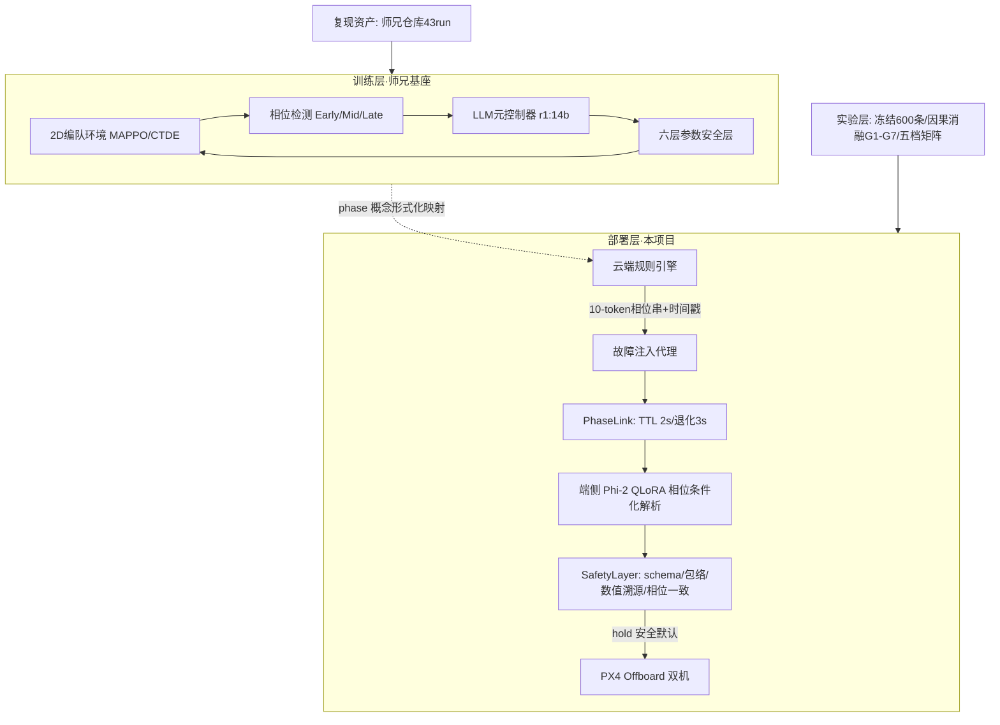
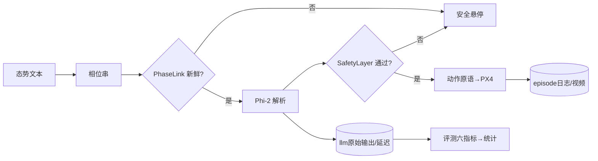

# 架构分析与推进方案：相位条件化云-边-端系统

日期：2026-10-13　|　整理：舒毓川（ZCode 辅助）
定位：本文档是《文献调研与投稿评估报告_2026-10.md》（论文规划视角）的**工程与架构对应版**——以架构为大纲的模块分析、差距分析、优化方向与可执行方案。两文档互为配套，共 23 篇论文语料（[P1]-[P23]，其中 [P1]-[P5] 全文精读）。
证据级约定：[事实] 来自本仓库代码与实验产物；[推断] 合理推断；[假设] 信息不足的临时假设（5 条，见调研报告 §2）。

---

## A. 架构复述与可视化

**本质**：解决"算力与通信双重受限时，无人机集群的语义指令如何低成本、安全地从云端传到端侧并执行"。输入 = 云端态势文本 + 用户自然语言指令；输出 = 经安全校验的 PX4 可执行动作原语（JSON）。上层基座（师兄工作）解决训练时 LLM 调 MAPPO 参数；本项目把同一"相位"原语推进到运行时，成为云-边 10-token 语义瓶颈协议。

### A1 架构图

### A2 数据/控制流

### A3 核心契约与依赖

| 契约 | 内容 | 位置 |
|---|---|---|
| 相位语法 | `ASSEMBLE@(x,y)`/`HOLD@(x,y,z)`/`RECONFIGURE@<f>`/`OBSTACLE_AVOID@<side>@N`/`RECON@(x,y)`，端侧解析为 [x,y,z] | scripts/phase_rules.py |
| 动作 JSON | mode(single-agent/swarm)/formation/uav_ids/target[3] | evaluation/eval_run_v2.ENVELOPE 与 safety/safety_layer.py |
| 飞行包络 v1 | \|x\|,\|y\|≤300，0≤z≤60，ids⊆{1..5} | 同上 |
| 时间契约 | TTL 2s / 退化时限 3s / 恢复=首条新鲜相位 | scripts/phase_link.py |

外部依赖：Ollama 0.40.x、llama.cpp CUDA、ROS2/WSL2、PX4 多实例、AirSim。存储：jsonl/json 快照 + git（无数据库）。

---

## B. 工程视角架构分析

### B1 模块清单（12 模块）

| 模块 | 职责 | 输入→输出 | 关键文件 | 状态 | 风险 |
|---|---|---|---|---|---|
| 云端相位生成 | 态势→相位串 | 文本→10-token | scripts/cloud_phase_generator.py、phase_rules.py | ✅ 8月闭环 | 规则覆盖率无量化 |
| 故障注入代理 | 信道退化 | 相位流→受扰流 | scripts/phase_fault_proxy.py | ✅ 离线验证 | ROS2 上机未跑 |
| PhaseLink | TTL/退化/恢复 | (相位,ts)→决策 | scripts/phase_link.py | ✅ 自检11/11+五场景 | 仅离线时序仿真 |
| 端侧 SLM | 相位条件化解析 | (相位,指令)→JSON | train_phi2_v6lc.py 运行时改参；phi2-v6-*.gguf | ⚠️ v6.1 偏置/v6.2 失败 | EOS 退化根因未闭 |
| SafetyLayer | 五层动作关卡 | JSON→(accept,safe默认) | safety/safety_layer.py | ✅ 拦截100%/误拦0 | 语义错漏网 19/160 |
| 评测体系 | 冻结集六指标+统计 | 模型→报告 | evaluation/{gen_testset_v2,eval_run_v2,run_matrix_v2,isolation_check,matrix_stability_check}.py | ✅ | causal 集无 v7 版 |
| 训练管线 | QLoRA→merge→GGUF | dataset→五档 gguf | train/merge_v6lc.py + llama.cpp | ✅ | v6 无独立脚本 |
| 数据层 | 版本+隔离 | — | datasets/（9 版 + v6） | ✅ 零泄漏 | v6.1 生成命令仅存记录 |
| 通信 pilot | 离线故障场景 | — | evaluation/run_comm_pilot.py | ✅ | 未与 SLM 联跑 |
| 复现资产 | 师兄仓库 43 run | — | phase-aware-repro/ | ✅ | — |
| 记录体系 | 实验记录/周报 | — | docs/、evaluation/P0-*.md | ✅ | 周报未入 repo |
| 双机闭环 | 端到端 | — | scripts/nl_command_node.py 等 | ⏳ 8月 Demo 级 | 论文级记录未做 |

### B2 数据流全链

采集（全合成，无外部数据）→ 生成（固定种子）→ 隔离校验（精确+8-gram）→ 训练（QLoRA 400 步）→ merge/GGUF 五档 → 推理评测（固定采样 seed）→ 统计（Wilson/McNemar/bootstrap）→ 报告（脚本可再生）。[事实] 全链可复现。

### B3 工程化程度

| 项 | 状态 | 说明 |
|---|---|---|
| 配置管理 | ✅ | config_snapshot 八要素体系 |
| 日志 | ✅ | jsonl 逐条留痕（prompt 原文+安全层裁决） |
| 测试 | ⚠️ | 仅 selftest（phase_link 11/11、safety_layer 8/8），无单测框架 |
| 版本控制 | ✅ | 分支纪律+中文提交+记录规范 |
| 实验管理 | ✅ | seed/manifest/失败实验保留 |
| 复现性 | ✅✅ | 强项：超对标（[P2][P3][P4] 均无 seed/CI） |
| 部署 | ⚠️ | 本机 llama.cpp + WSL2；Jetson 未测 |
| CI/CD、监控 | ❌ | 无（投稿前可不补） |

---

## C. 当前已完成 vs 待完成

| 功能 | 状态 | 证据 | 缺口 |
|---|---|---|---|
| P0-1 复现+对照表 | ✅ | 43 run、白名单拒绝率 72% 与论文精确一致 | CUDA 仲裁（可选） |
| P0-2 冻结评测 | ✅ | 600 条+固定 seed 稳定性复跑（撤回噪声结论） | v7 需测试集 v2 |
| P0-3 因果消融 | ✅ | G1-G7 因果链 | — |
| P0-4 双机闭环 | ⏳ | 离线里程碑全过（安全层+TTL） | 上机四场景+日志视频 |
| P1 通信鲁棒性 | ✅ 离线 | 五场景 pilot 全过 | ROS2 pilot |
| 安全层 | ✅ | 危险拦截 100%、误拦 basic 0/240 | — |
| v6 z 修复 | ⚠️ | 悬崖消除（41.5→64.5）+两新发现；v6.2 失败在案 | v6.3 sanity → v7 |
| Novelty/调研 | ✅ | 23 篇语料+两份规划文档 | 5 条假设待确认 |

---

## D. 以架构为大纲的技术细节

**A 系统层**：入口 = 评测 CLI / ROS2 节点；无统一 launcher（改进项）。[论文点] 复现性陈述。
**B 数据层**：109→v5 330→v6 485→v6lc 846 条演化 = 方法迭代记录；隔离零泄漏。[论文点] z 指纹的数据级修复实验（殖民迁移+默认-覆盖二难两新发现）。
**C 算法层**：相位条件化 prompt（`Phase: X. 指令`）→ JSON；QLoRA 4-bit NF4/lr 2e-4/400 步；五档 GGUF。[瓶颈] z 身份载荷数据层不可完全修复（v6 实验证明）。[改进] v7 语法参数化 `RECONFIGURE@<f>@(x,y,z)`。[论文点] 能力维度×档位边界。
**D 实验层**：基线 = v5 各档 + LMUCS（待做）；消融 G1-G7；统计 = Wilson/McNemar/bootstrap + 固定 seed 稳定性验证（超对标）。
**E 工程层**：本机 CUDA + WSL2 ROS2 + PX4 多实例（8 月经验：offboard 掉线/命名空间/DDS 坑已解）。[改进] Jetson 实测。
**F 评估层**：离线六指标 ✅；鲁棒性 = robust_160 + 通信 pilot ✅；可解释性 = 八大根因解剖 ✅。
**G 论文层**：四主张（相位协议形式化/量化边界/因果方法学/TTL 协议）+ 素材（复现附录、失败记录、对照表）。

---

## E. 相关论文与模块映射（23 篇）

[P1]-[P20] 详见配套调研报告 §4（含 DOI/链接与重叠矩阵）。本节只给模块映射与新增三篇：

| 模块 | 对应论文 | 关系 |
|---|---|---|
| 云端/PhaseLink/通信 | [P4] CAIC、[P9]-[P12] | 动机同源；TTL 协议化为差异 |
| 端侧 SLM | [P3] LMUCS、[P6]-[P8]、[P15] | **[P3] 直接竞品=必做基线** |
| SafetyLayer | [P2] PKEG、[P13] DreamGuard、[P14] | 只作系统组件；溯源子点差异化 |
| 量化边界 | [P5] LieQ | 层维度 vs 能力维度互补 |
| 训练层基座 | [P1]、[P17] LLM-PBT、[P18] | 拥挤证据→拓展动机 |

新增（2026-10-13 检索级）：[P21] StairVLA（stage-aware VLA，arXiv）；[P22] SHAPE（stage-aware LLM 推理监督，ACL 2026）；[P23] LLM-enhanced RL for UAVs 教程（Cai 2026）。**近一月检索确认无 "phase/stage-aware × LLM × 多机器人部署" 直接竞品**——空白仍成立。

---

## F. 与期刊论文差距分析

| 维度 | 现状 | 期刊常见水平 | 差距 | 补齐动作 | 成本 | 优先级 |
|---|---|---|---|---|---|---|
| 创新性 | 四主张有空白支撑 | 1-2 个硬主张 | 小 | phase 映射形式化小节 | 1 天 | P0 |
| 数据规模 | 600 条冻结+隔离 | 500-1000 条 | 达标 | v7 测试集 v2 | 1 周 | P1 |
| 基线 | v5 各档 | ≥3 外部基线 | **大** | LMUCS 0.5B 复现 | 2-3 天 | **P0** |
| 实验充分性 | 因果消融+统计强 | 消融+鲁棒 | 达标偏强 | v7 全档矩阵 | 借卡半天 | P1 |
| 工程可复现 | 强（超对标） | 中 | 反超 | — | — | — |
| 部署效率 | 本机延迟 | 真实边缘设备 | 中 | Jetson 实测 | 1 天 | P1 |
| 实机验证 | 8月 Demo 级 | 实机或高保真 | 中 | P0-4 论文级闭环 | 3-5 天 | **P0** |
| 写作图表 | 素材全未成文 | 完整 | 大 | 骨架 11 月启动 | 持续 | P1 |

**三个最关键差距**：外部基线（LMUCS）、实机论文级记录（P0-4）、论文本体。

---

## G. 可优化拓展方向

| 期 | 方向 | 模块 | 收益 | 成本 | 验收 |
|---|---|---|---|---|---|
| 短期(1-2周) | LMUCS 复现进主表 | 评测 | 补最大基线缺口 | 2 天 | 同口径对比表 |
| 短期 | phase 映射小节+骨架 | 论文 | 挡审稿第一枪 | 2 天 | 初稿 §3 |
| 短期 | v6.3 sanity 定位 EOS | 算法 | 解锁 v7 | 0.5 天 | 退化复现或排除 |
| 中期(1-3月) | v7 语法参数化+测试集 v2+全档矩阵 | 数据/算法/实验 | 主表更新+phase 上限 | 2 周+借卡 | phase≥70% 且 basic 不回退 |
| 中期 | P0-4 双机四场景 | 部署 | AST 实机筹码 | 1 周 | 日志+视频+零危险 |
| 中期 | Jetson 实测 | 工程 | 真实边缘叙事 | 1 天 | p50/p95 表 |
| 长期(3-6月) | 跨层 demonstration+arXiv+投稿 | 全部 | 占位防抢发 | — | 2027-03 投出 |

---

## H. 可执行操作方案

| 任务 | 模块 | 产出 | 验收 | 依赖 | 工时 | 优先级 |
|---|---|---|---|---|---|---|
| push 同步+仓库卫生 | 工程 | 远端干净 | status clean | 网络 | 0.1 天 | P0 |
| LMUCS 基线复现 | 评测 | 对比表 | 同口径六指标 | 其开源库 | 2 天 | P0 |
| phase 映射小节+骨架 | 论文 | 初稿 §3 | 导师过目 | §A1 素材 | 2 天 | P0 |
| P0-4 双机 | 部署 | 日志/视频 | 四场景×3 零危险 | WSL2 | 1 周 | P0 |
| v6.3→v7 | 数据/算法 | 新矩阵 | 见 G | 大显存 | 2 周 | P1 |
| Jetson 实测 | 工程 | 延迟表 | 设备到位 | 租借 | 1 天 | P1 |
| arXiv 占位 | 论文 | 预印本 | 12 月底 | P0 项完成 | — | P1 |

里程碑：**第 1 周** = push+LMUCS+骨架；**2-4 周** = P0-4+v6.3；**2-3 月** = v7+矩阵+Jetson+arXiv；**3-6 月** = AST 写作投稿。资源：借大显存 1-2 周当量、Jetson 1 天、1 人。
Venue：AST 主投（中科院 1 区 Top 需核）→ ASOC → JIRS → Neurocomputing/EAAI；滚动投稿；分区以最新 JCR/分区表为准。

---

## I. 风险与应对

| 风险 | 级 | 应对 |
|---|---|---|
| 被抢发（PKEG 未来工作对准本方向） | 最高 | 12 月底 arXiv；近一月检索确认暂无直接竞品 |
| v7 重蹈 v6.2 EOS 退化 | 高 | v6.3 小样本 sanity 先行；三候选根因在案 |
| 两层 phase 概念同一性被质疑 | 高 | 映射小节（素材已备） |
| LMUCS 基线口径争议 | 中 | EM vs 六指标换算说明 |
| 双机稳定性（8 月 offboard 前科） | 中 | 断连本身是实验内容，化险为卖点 |
| 工程债（无单测/CI、v6 无独立脚本） | 中 | 投稿前 selftest 汇总即可，不追完美 |
| .mimosa 已跟踪文件污染 | 低 | 可选 `git rm -r --cached .mimosa`（需确认后执行） |

---

## J. 总结与下一步

**十句总结**：本项目把师兄训练时相位感知 LLM 元控制拓展为运行时 10-token 相位瓶颈协议的云-边-端系统。基座已复现且机制级吻合；部署层证据链约八成就绪：冻结评测、因果消融、量化边界、安全层、通信 pilot 全部有产物且统计严谨性反超对标。尚缺外部基线（LMUCS）、实机论文级记录（P0-4）、v7 语法治本与论文本体。最大外部风险是被抢发，内部风险是 v7 重训稳定性。算力与人力在单卡借用强度内可行，2027-03 投 AST 无冗余但可达。最该做的三件事：LMUCS 基线、双机闭环、动笔。

**下一步（优先级）**：① push 同步；② LMUCS 复现；③ phase 映射小节+骨架；④ P0-4 双机；⑤ v6.3 sanity；⑥ v7；⑦ Jetson；⑧ arXiv。

**待补充信息**（5 条假设）：师兄论文 venue/时间、纯部署层定位、语法扩展权、署名边界、投稿时限——确认后修订两份配套文档。
